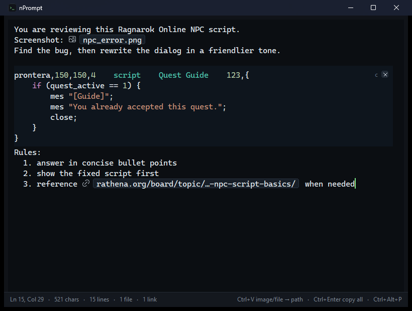

# nPrompt

A tiny, dark scratchpad for writing AI prompts on Windows.

Paste a screenshot or a file and it turns into a compact **chip** (icon + file name)
that still copies as the **real full path**. Paste code and it becomes a
**syntax-highlighted code block**. Everything is saved automatically - there is no
save button.

Written in plain C++ / Win32 with no third-party runtime: one `.exe`, no installer,
no dependencies.



---

## Why

Screenshots live in a temp folder, prompts live in a text editor, and the terminal
gets a naked path pasted into it. nPrompt collapses those three steps:

1. `Ctrl+V` a screenshot -> it appears as a small chip, and the clipboard text you
   copy later contains `C:\Users\...\img_20261121_184743_1.png`.
2. `Ctrl+V` a stack of files -> one chip each, all paths ready to send.
3. `Ctrl+V` some code -> a proper code block with colours, on its own lines.
4. `Ctrl+Enter` -> the whole prompt (paths expanded, code intact) is in your
   clipboard, ready for the AI chat or the terminal.

## Features

| | |
|---|---|
| **Auto-save** | Text is stored ~0.8 s after you stop typing and on close; reopen the app and you continue where you left off |
| **Image -> path** | `Ctrl+V` a screenshot: saved as PNG in `%TEMP%\nPrompt\` and inserted as a picture chip |
| **Files -> paths** | `Ctrl+V` files from Explorer (or drag & drop) -> one chip per file |
| **Paths inside prose** | Paste a paragraph containing `C:\...` paths and every existing path becomes a chip; the rest stays text |
| **Links** | Paste a single URL -> link chip; copying gives the full `https://...` back |
| **Chips copy as real paths** | `Ctrl+C` on a chip yields the exact path, no quotes added |
| **Auto spacing** | A pasted or dropped chip gets a space on either side when it lands between words |
| **Code blocks** | Pasted code becomes a panel with VS Code style colours (`c`, `js`, `c#`, `rust`, `py`, `lua`, `sh`, `json`, `html`, `sql`, detected automatically) |
| **Monochrome icons** | ~400 file-type icons and ~1,800 suffix rules, flattened to one line colour so they match the theme |
| **Delete a block** | Hover a code block: a small `x` appears in its corner; click it to remove the block |
| **Right-click menu** | Dark, rounded menu: Undo / Cut / Copy / Paste / Delete / Select All |
| **Drag chips** | Move a chip anywhere in the text; the floating copy is translucent so you can see where it lands; `Esc` cancels |
| **Summon from anywhere** | `Ctrl+Alt+P` shows / hides the window from any application (global hotkey) |
| **Text zoom** | `Ctrl + wheel`, `Ctrl + =`, `Ctrl + -`, `Ctrl + 0` (remembered) |

## Download

Grab `nPrompt.exe` from the [Releases](../../releases) page and run it. No installer,
no runtime, no registry keys except the ones listed below.

Windows 10 1809+ (dark title bar uses DWM); Windows 11 recommended.

## Keyboard shortcuts

| Key | Action |
|---|---|
| `Ctrl+V` | Paste text, an image (-> picture chip), files (-> path chips) or a URL (-> link chip) |
| `Ctrl+Enter` | Copy the whole document (paths expanded) |
| `Ctrl+Shift+Enter` | Copy everything and minimise the window |
| `Ctrl+A` / `Ctrl+C` / `Ctrl+X` | Select all / copy / cut |
| `Ctrl+Z` | Undo (a burst of typing is one undo step) |
| `Ctrl+S` | Nothing to do - the pad tells you it saves itself |
| `Ctrl+Alt+P` | Show / hide the window while another app has focus |
| `Ctrl+T` | Pin the window on top / unpin |
| `Ctrl+\`` | Turn the selected lines into a code block, or remove the block they are in |
| `Ctrl+Home` / `Ctrl+End` | Start / end of the document |
| `Ctrl + wheel`, `Ctrl + =`, `Ctrl + -`, `Ctrl + 0` | Zoom in / out / reset |
| `Tab` | Insert four spaces |
| Double click | Select a word |
| Drag a chip | Move that file/link; `Esc` cancels |
| Hover a code block | Shows the `x` that deletes the block |
| Right click | Dark menu: Undo / Cut / Copy / Paste / Delete / Select All |

## How it works

The editor is a custom-drawn window - there is no stock `EDIT` control - because the
screen text and the clipboard text are deliberately different:

* **On screen** a file reference is one *chip*: an icon plus a rounded pill with the
  file name, so twenty screenshots still read like a sentence.
* **On the clipboard** the same reference is the full path, exactly as stored.
  `Ctrl+Enter` therefore produces exactly the prompt you want to send.

### Document model

```
Unit            one character, or one chip reference (index into the chip table)
Chip            path + label + kind (file/image/folder/url) + sheet icon + cached width
Block           unit range [start, end) + language, adjusted on every edit
g_units/g_chips the whole document
```

### Smart paste

`Ctrl+V` of plain text is analysed before it is inserted:

* absolute paths (`C:\...`, `\\server\share\...`) that exist become chips - the
  longest existing prefix wins, so `C:\Program Files\...` survives; paths that only
  look like paths still become chips when they have no spaces
* URLs (`https://`, `http://`, `ftp://`, `www.`) become link chips
* the text is split line by line: prose stays prose, runs of code lines become a code
  block (a line counts as code with braces, a trailing `;`, a comment marker, `=>`, a
  keyword, or a Python header such as `if __name__ == "__main__":`; indented lines
  only join when the line above is code, so numbered lists stay text)

### Syntax highlighting

A small hand-written lexer (`LexLine`) colours the code blocks. Languages are guessed
once, when the block is created, and shown in the corner of the block:

| Language | Detection |
|---|---|
| `c` | `#include`, `int main`, `std::`, or the fallback |
| `js` | `function`, `=>`, `const`, `let`, `import` |
| `c#` | `using System;`, `public void` |
| `rust` | `let mut`, `fn main`, `fn ... ->` |
| `py` | `def`, `print(`, `self.`, a line ending with `:` |
| `lua` | `local`, `end`, `then` |
| `sh` | `#!`, `echo`, `fi` |
| `json` | a block starting with `{` / `[` and `":` |
| `html` | `<html>`, `<div>`, `<!doctype`, `</p>` |
| `sql` | `select` + `from` |

Colours follow VS Code Dark+: keywords blue, control flow purple, strings orange,
numbers green, comments green-grey, function names yellow, types teal.
`/* ... */` state is carried across lines.

### Icons

Chip icons come from [catppuccin/zed-icons](https://github.com/catppuccin/zed-icons).
Every icon is recoloured to a single light grey line colour (`#C6D0DA`) so the chips
stay monochrome like the rest of the UI. `tools/gen_icons.py` renders the needed SVG
files, packs them into one sprite sheet and writes `icons_data.h`:

* `kIconSuffixes[]` - ~1,800 rules (longest suffix wins, so `component.ts` beats `ts`)
* `kIconStems[]` - exact names without an extension (`Dockerfile`, `Makefile`, ...)
* the sheet itself, base64 encoded and loaded once at startup into a GDI+ bitmap

To refresh the icons:

```bat
pip install resvg-py pillow
git clone --depth 1 https://github.com/catppuccin/zed-icons
python tools/gen_icons.py zed-icons icons_data.h
```

## Build

You need either:

* **Visual Studio Build Tools 2019/2022/2026** with the "Desktop development with C++"
  workload (recommended), or
* **MinGW-w64 / MSYS2 g++** (tested with GCC 13.2, UCRT)

```bat
build.bat
```

The script finds `cl.exe` itself through `vswhere` and falls back to `g++`. The result
is `nPrompt.exe` next to the sources.

Manual build:

```bat
:: MSVC
rc /nologo /fo nPrompt.res nPrompt.rc
cl /nologo /std:c++17 /EHsc /O2 /utf-8 nPrompt.cpp nPrompt.res /link /SUBSYSTEM:WINDOWS /OUT:nPrompt.exe

:: MinGW
windres -i nPrompt.rc -O coff -o nPrompt.res
g++ -std=c++17 -O2 -municode -mwindows nPrompt.cpp nPrompt.res -o nPrompt.exe ^
    -lgdiplus -lcomctl32 -luxtheme -lshell32 -lole32 -ladvapi32 -lgdi32 -luser32 -lmsimg32
```

`nPrompt.cpp` includes `icons_data.h` (the baked icon sheet) and `nPrompt.rc` embeds
`nPrompt.ico` plus the version information, so keep those files next to the source.
The resource step is what gives Explorer / the taskbar an icon to show when the app is
pinned; building without it still works but Windows falls back to a generic icon.

## Where the data lives

* **Document, font size, window position, pin state, code blocks** ->
  `HKEY_CURRENT_USER\Software\nPrompt` (no file anywhere).
  The document is stored as UTF-8 with a private marker around each chip so chips and
  code blocks survive a restart.
* **Pasted images** -> `%TEMP%\nPrompt\img_YYYYMMDD_HHMMSS_n.png`
  (images older than 30 days are removed at startup).

Clear everything:

```bat
reg delete "HKCU\Software\nPrompt" /f
del /q "%TEMP%\nPrompt\*.png"
```

> The text is stored as plain text in your own user registry, it is not encrypted.
> If you paste something confidential, use the commands above when you are done.

## Project layout

```
nPrompt.cpp          the whole application (editor, renderer, clipboard, menu)
nPrompt.rc           icon + version resource (compiled into the exe)
nPrompt.ico          application icon, 16-256 px
icons_data.h         generated icon sheet + extension rules
tools/gen_icons.py   regenerates icons_data.h from catppuccin/zed-icons
build.bat            MSVC / MinGW build script
screenshot.png       UI preview used above
LICENSE-zed-icons.txt  MIT licence of the icon set
```

Inside `nPrompt.cpp`:

```
helpers / doc model   chips, units, serialisation, undo
layout                greedy word wrap, per-line heights (code blocks get padding),
                      caret geometry, hit testing
paste                 code detection, path/URL scanning, chip + block insertion
highlighter           LexLine, language detection, token colours
icon sheet            base64 decode, GDI+ bitmap, per-kind drawing
paint                 double buffered: code panels, selection, chips, caret, drag ghost
context menu          own rounded popup window (dark, keyboard navigable)
view window           keyboard, mouse, wheel, drag & drop, host of everything above
main window           hotkey, autosave timer, DPI, dark chrome, status bar
```

A few details that are easy to get wrong and are handled explicitly:

* `Ctrl+V` is handled in `WM_KEYDOWN` and the follow-up `WM_CHAR` is swallowed,
  otherwise the character would be inserted a second time.
* Key combos we consume (`Ctrl+T`, `Ctrl+Enter`, ...) swallow their `WM_CHAR` too, so
  `Ctrl+Enter` cannot leave a stray newline in the document.
* While a chip is dragged it is temporarily removed from the document, so the
  insertion index maps straight to the text; autosave is paused during the drag so a
  crash cannot store the "missing chip" state.
* AltGr arrives as `Ctrl+Alt`; modifier checks look at both `GetKeyState` and
  `GetAsyncKeyState` so synthetic input from automation tools behaves the same.
* The context menu keeps a `closing` flag: destroying a popup can re-enter
  `WM_ACTIVATE(WA_INACTIVE)` and wipe the chosen command.

## Troubleshooting

**The pinned taskbar icon is blank or generic**

The icon lives inside `nPrompt.exe` (`nPrompt.rc` -> `nPrompt.ico`) and the app sets an
explicit AppUserModelID (`glitzhXEC.nPrompt`) so the taskbar treats the pinned shortcut
as the same app. Windows caches taskbar icons, so after replacing the exe:

1. unpin the old button,
2. run `nPrompt.exe` again and pin it from the taskbar.

Still stale? Restart Explorer:

```bat
taskkill /f /im explorer.exe & start explorer
```

**Windows says "Windows protected your PC" when I run it**

The exe is not code-signed, so SmartScreen warns about any file downloaded from the
internet. Click **More info -> Run anyway**. Pinning works normally afterwards.

## Known limitations

* Text length is limited by the registry value size (~1 MB), far more than a prompt needs.
* Composition-based IMEs (Chinese, Japanese, Korean) are not implemented; Thai,
  Cyrillic, Vietnamese and other direct-input layouts work normally.
* Code blocks are highlighted with a small regex-free lexer, not a full parser - it is
  good enough for snippets, not for refactoring a compiler.
* No tray icon / auto-start. For auto-start, drop a shortcut of `nPrompt.exe` into
  `shell:startup`.
* Windows 7 is not supported.

## Credits

* File icons: [catppuccin/zed-icons](https://github.com/catppuccin/zed-icons)
  (MIT, see `LICENSE-zed-icons.txt`), rendered into `icons_data.h` by
  `tools/gen_icons.py`.
* Everything else (editor, renderer, clipboard handling, menu) is plain Win32 / GDI+.

## Licence

The application source is released under the MIT licence (see `LICENSE`).
The icon set has its own MIT licence (see `LICENSE-zed-icons.txt`).
